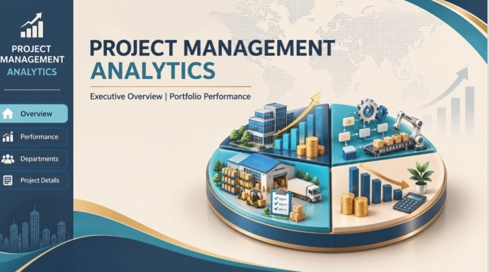
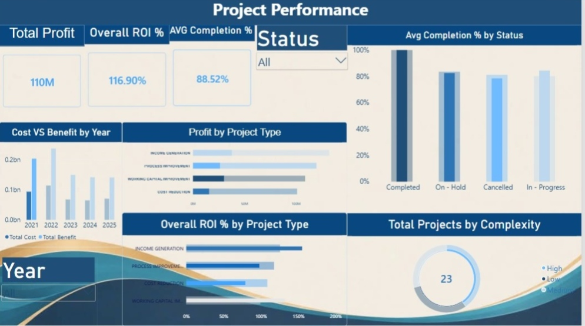

# Project Management Analytics - Power BI Dashboard

A Power BI dashboard for analyzing company projects, profitability, costs, benefits, department performance, and project status.

## Key Metrics

- **Total Projects:** 99
- **Total Cost:** 412M
- **Total Benefit:** 874M
- **Total Profit:** 462M
- **Overall ROI:** 116.90%
- **Average Completion:** 88.52%
- **Departments:** 5

## Dashboard Pages

### Cover
Main cover page with navigation to all dashboard pages.

### 1. Project Overview
A high-level overview of all projects by region, type, year, and profitability.

### 2. Project Performance
Project performance analysis including profit, ROI, completion rate, cost vs benefit, and project status.

### 3. Department Analysis
Department-wise analysis of profit, cost, benefit, number of projects, and project managers.

### 4. Project Details
Detailed table of all 99 projects with project type, department, project manager, region, status, completion rate, and cost.

## Insights

- The most profitable department is Warehouse with 114M profit.
- Supply Chain has the highest number of projects.
- 2022 was the most active year with 27 projects.
- Income Generation is the most common project type with 27 projects.
- North region has the highest number of projects, while East has the lowest.

## Tools Used

- Microsoft Power BI
- DAX
- Power Query

## Files

- `Project_Management_Analytics.pbix` - Main Power BI file
